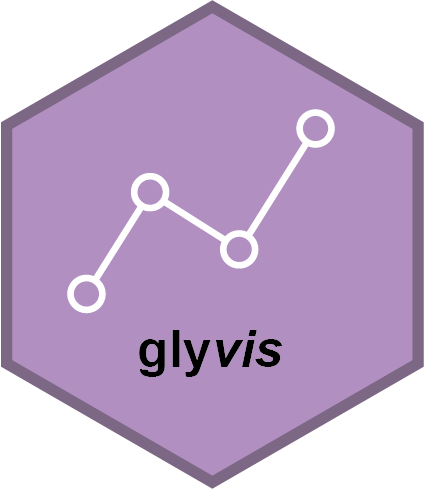
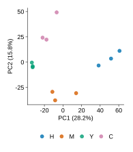
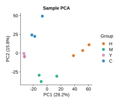

<!-- README.md is generated from README.Rmd. Please edit that file -->

# glyvis <a href="https://glycoverse.github.io/glyvis/"></a>

<!-- badges: start -->

[](https://lifecycle.r-lib.org/articles/stages.html#experimental)
[](https://glycoverse.r-universe.dev/glyvis)
[](https://github.com/glycoverse/glyvis/actions/workflows/R-CMD-check.yaml)
[](https://app.codecov.io/gh/glycoverse/glyvis)
<!-- badges: end -->

The goal of glyvis is to visualize everything in the `glycoverse`
ecosystem. Visualization is an essential part of data analysis. Human
beings are more sensitive to visual information than text and numbers.
Plotting helps us to understand the data better. `glyvis` provides a
unified interface for visualizing `glycoverse` data, including
statistical results and experimental data. It implements the
`autoplot()` method for various `glycoverse` data structures. Just
`autoplot()` it!

## Installation

### Install glycoverse

We recommend installing the meta-package
[glycoverse](https://github.com/glycoverse/glycoverse), which includes
this package and other core glycoverse packages.

### Install glyvis alone

If you don’t want to install all glycoverse packages, you can only
install glyvis.

You can install the latest release of glyvis from
[r-universe](https://glycoverse.r-universe.dev/glyvis)
(**recommended**):

``` r
# install.packages("pak")
pak::repo_add(glycoverse = "https://glycoverse.r-universe.dev")
pak::pkg_install("glyvis")
```

Or from [GitHub](https://github.com/glycoverse/glyvis):

``` r
pak::pkg_install("glycoverse/glyvis@*release")
```

Or install the development version (NOT recommended):

``` r
pak::pkg_install("glycoverse/glyvis")
```

**Note:** Tips and troubleshooting for the meta-package
[glycoverse](https://github.com/glycoverse/glycoverse) are also
applicable here: [Installation of
glycoverse](https://github.com/glycoverse/glycoverse#installation).

## Documentation

-   🚀 Get started:
    [Here](https://glycoverse.github.io/glyvis/articles/glyvis.html)
-   📚 Reference:
    [Here](https://glycoverse.github.io/glyvis/reference/index.html)

## Role in `glycoverse`

The main purpose of `glyvis` is to provide visualization for `glystats`
results. It implements `autoplot()` methods for each result class in
`glystats`, so that the users can visualize the results directly to get
a quick overview. It also provides some other visualization functions
for `glycoverse` data structures, such as `glyexp::GlycomicSE`,
`glyexp::GlycoproteomicSE`, `glyrepr::glycan_structure()`, and others.
All plotting entry points use [tidyplots](https://tidyplots.org/) and
return composable `tidyplot` objects. Defaults use a white background,
restrained colors, and readable typography; adjust the returned plot for
your output size and audience.

## Example

``` r
library(glyexp)
library(glyclean)
library(glystats)
library(glyvis)

set.seed(42)
exp <- auto_clean(real_experiment)

pca_res <- gly_pca(exp)
autoplot(pca_res)
```



## Customize and export

``` r
plot_pca(exp, title = "Sample PCA", fontsize = 9,
         palette = c(C = "#0072B2", H = "#D55E00", M = "#009E73", Y = "#CC79A7")) |>
  tidyplots::adjust_legend_title("Group")
```



All `plot_*()` and `autoplot()` entry points accept `title`, `fontsize`,
`family`, `palette`, `width`, and `height`. Plot areas use tidyplots’
default 50 by 50 mm size; set `width = NA, height = NA` to fill the
graphics device instead. Use named palettes to keep group colors fixed
across plots and subsets. Scatter plots show points without labels by
default; set `label = TRUE` when individual identities matter. No
observations are removed for presentation; ranked plots and loadings
accept an explicit `top_n`.

``` r
p <- plot_boxplot(exp[1:4, ], ncol = 2, scales = "fixed")
tidyplots::save_plot(p, "boxplots.pdf")
```

Heatmaps preserve clustering order and missing values, with a symmetric
color scale for standardized values. Dendrograms are available
separately through `autoplot(glystats::gly_hclust(exp))`.

The backend migration replaces options specific to factoextra,
EnhancedVolcano, GGally, and pheatmap. Use `label` instead of PCA
`geom`/`repel`, `point_size` instead of volcano `pointSize`, and pass
sequence-logo geometry options in `logo_args`. Unsupported arguments
produce an error. See `?glyvis_plot_options` for the complete options
and migration guide.
