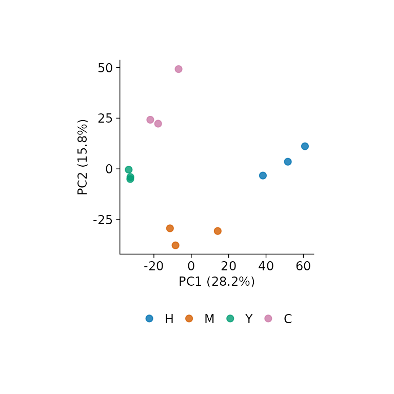
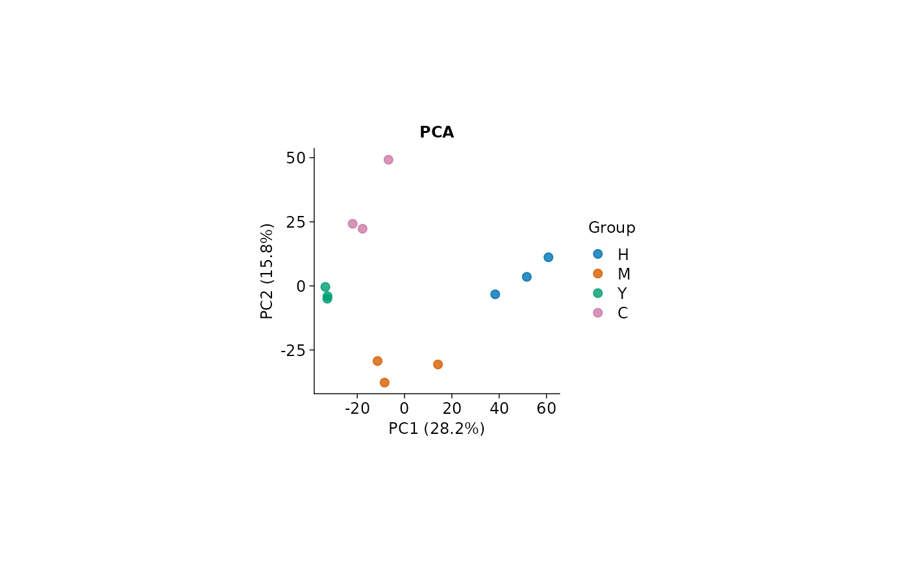

# Get Started with glyvis

> “The simple graph has brought more information to the data analyst’s
> mind than any other device.” — John Tukey

Data visualization isn’t just another step in your analysis
pipeline—it’s where insights come alive. As visual creatures, we process
charts and graphs far more intuitively than walls of numbers and text.
`glyvis` brings this visual power to the `glycoverse`, offering
lightning-fast and effortless visualization for your glycomics data.
Built as the perfect companion to `glystats`, it transforms complex
statistical results into clear, compelling visuals.

``` r

library(glyvis)
library(glyexp)
#> Warning: replacing previous import 'S4Arrays::makeNindexFromArrayViewport' by
#> 'DelayedArray::makeNindexFromArrayViewport' when loading 'SummarizedExperiment'
library(glyclean)
#> 
#> Attaching package: 'glyclean'
#> The following object is masked from 'package:stats':
#> 
#>     aggregate
library(glystats)
```

Let’s dive in with some real data to see `glyvis` in action. We’ll work
with the `real_experiment` dataset bundled with `glyexp`— a compelling
real-world N-glycoproteomics study featuring 12 patients across four
distinct liver conditions: healthy controls (H), hepatitis (M),
cirrhosis (Y), and hepatocellular carcinoma (C), with 3 samples
representing each condition. To get our data analysis-ready, we’ll use
[`glyclean::auto_clean()`](https://glycoverse.github.io/glyclean/reference/auto_clean.html)
for streamlined preprocessing.

``` r

exp <- auto_clean(real_experiment)
#> 
#> ── Removing variables with too many missing values ──
#> 
#> ℹ Applying preset "discovery"...
#> ℹ Total removed: 24 (0.56%) variables.
#> ✔ Variable removal completed.
#> 
#> ── Normalizing data ──
#> 
#> ℹ Normalization method: `normalize_median()`
#> ℹ Reason: default for "glycoproteomics".
#> ✔ Normalization completed.
#> 
#> ── Imputing missing values ──
#> 
#> ℹ Imputation method: `impute_min_prob()`
#> ℹ Reason: default for "glycoproteomics" with n_samples < 30.
#> ✔ Imputation completed.
#> 
#> ── Aggregating data ──
#> 
#> ✔ Aggregation completed.
#> 
#> ── Normalizing data again ──
#> 
#> ℹ Normalization method: `normalize_median()`
#> ℹ Reason: default for "glycoproteomics".
#> ✔ Normalization completed.
#> 
#> ── Correcting batch effects ──
#> 
#> ℹ Batch column batch not found in sample_info. Skipping batch correction.
#> ✔ Batch correction completed.
```

## The Dual Nature of `glyvis`

Think of `glyvis` as a versatile artist with two distinct painting
styles:

- **[`autoplot()`](https://ggplot2.tidyverse.org/reference/autoplot.html)**
  — The intelligent assistant that automatically crafts suitable plots
  from your `glystats` results
- **`plot_xxx()`** — The precision toolkit for creating specific
  visualizations exactly as you envision them

Let’s see this in action. To create a PCA plot, we can take the direct
route with
[`plot_pca()`](https://glycoverse.github.io/glyvis/dev/reference/plot_pca.md)
on our `exp` data:

``` r

plot_pca(exp)
```



Alternatively, we can take the analytical pathway: first conducting PCA
analysis with
[`glystats::gly_pca()`](https://glycoverse.github.io/glystats/reference/gly_pca.html),
then letting
[`autoplot()`](https://ggplot2.tidyverse.org/reference/autoplot.html)
work its magic on the statistical results.

``` r

pca_res <- gly_pca(exp)
autoplot(pca_res)
```


While the first approach gets you there quickly, the second pathway
unlocks a world of possibilities with your results. You gain access to
the underlying statistical objects for advanced analyses, and can craft
custom `ggplot2` masterpieces tailored for publications.

The beauty of
[`autoplot()`](https://ggplot2.tidyverse.org/reference/autoplot.html)
lies in its versatility—it speaks fluent `glystats` across nearly every
analysis type. Explore [the complete
reference](https://glycoverse.github.io/glyvis/reference/index.html) to
discover the full spectrum of
[`autoplot()`](https://ggplot2.tidyverse.org/reference/autoplot.html)
capabilities and specialized `plot_xxx()` functions.

## Consistent graphics with tidyplots

All entry points return a `tidyplot` that can be modified with tidyplots
pipes or ggplot2 layers. White backgrounds, modest line widths, and a
common font size keep emphasis on the observations. No global plotting
options are changed.

``` r

plot_pca(exp, title = "PCA", fontsize = 9) |>
  tidyplots::adjust_legend_title("Group")
```



Use `label = TRUE` to identify individual points and a named `palette`
to preserve group colors across subsets. Boxplots show raw observations
over quartile boxes; `scales = "fixed"` makes their axes comparable
across facets. Heatmaps keep their clustering order but use a tidyplots
heatmap without an embedded dendrogram. Use the hierarchical-clustering
[`autoplot()`](https://ggplot2.tidyverse.org/reference/autoplot.html)
method when the tree itself is the question.

Export with explicit physical dimensions using
[`ggplot2::ggsave()`](https://ggplot2.tidyverse.org/reference/ggsave.html)
or
[`tidyplots::save_plot()`](https://jbengler.github.io/tidyplots/reference/save_plot.html).
Inspect the result at that size, particularly for long glycopeptide
identifiers and large numbers of categories. Choose a meaningful subset
explicitly with `top_n` for ranked plots or loadings when appropriate.
See
[`?glyvis_plot_options`](https://glycoverse.github.io/glyvis/dev/reference/glyvis_plot_options.md)
for common options, plot-specific controls, and migration from the
former plotting backends.
